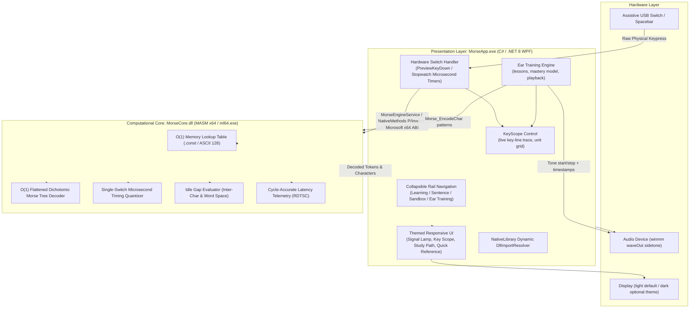

# CONTEXT.md — MorseCodeLearner Architecture & System Context

## 1. Project Overview & Problem Statement

### 1.1 The Assistive Problem
For individuals with severe motor restrictions (e.g., ALS, cerebral palsy, spinal cord trauma), traditional mechanical keyboards and touchscreens demand fine motor control that is inaccessible. Modern commercial speech-to-text or heavy graphical assistive devices often require substantial hardware resources or high operating system overhead that fails in resource-constrained or legacy environments.

Morse code serves as an ultra-low-complexity binary communication protocol capable of bridging auditory, visual, and tactile domains. However, existing pedagogical tools programmed in high-level managed languages introduce non-deterministic execution jitter, garbage collection pauses, and lack low-overhead, hardware-near interactive platforms capable of executing at the system architecture level.

### 1.2 System Objective
To design, implement, and evaluate an **Assembly-based Morse Code Assistive and Pedagogical Platform** that enables individuals with visual, auditory, or motor impairments, as well as students of computer architecture, to systematically practice and utilize Morse code with zero computational latency and deterministic input quantization.

### 1.3 Learning-Science Objective (added with the Ear Training work)
Beyond fast input handling, the platform must help a learner **retain** Morse code. The design therefore combines three ideas, each implemented in the application:
1. **Multi-sensory redundancy** — every signal is available as sound (sidetone), as a visual trace (key scope, lamp, diagrams), and as text (phonetics, patterns), so a learner with an auditory or visual impairment can lean on the other channels.
2. **Immediate, quantitative timing feedback** — the learner sees how long they held the key against the target unit length while they are adjusting speed (§5).
3. **Spaced, weakness-weighted repetition with staged introduction** — characters are introduced in small groups and re-drilled until a mastery criterion is met (§6).

---

## 2. Decoupled Hybrid Architecture

The platform adopts a decoupled hybrid architecture separating raw computational machine-level operations from high-level presentation and accessibility services:



**Design note.** The native core remains the single source of truth for Morse semantics: pattern encoding (`Morse_EncodeChar`), decoding (`Morse_DecodeChar`), press classification (`Morse_QuantizePress`) and gap evaluation (`Morse_EvaluateGap`). The managed layer never keeps its own copy of the Morse table for *behaviour*; the Ear Training playback, the lesson diagrams, the Quick Reference chart and the key-scope classification all call the same native routines. (Only the human-readable phonetic strings, e.g. "di-dah", are managed-side data.)

---

## 3. Low-Level ABI & Mathematical Specifications

### 3.1 Microsoft x64 Calling Convention
All routines exported from `MorseCore.dll` follow the standard Microsoft x64 Calling Convention:
- **Integer / Pointer Arguments**: Passed in `RCX`, `RDX`, `R8`, `R9`.
- **Return Values**: Passed in `RAX` (`AX` for 16-bit words, `AL` for bytes).
- **Caller Shadow Space**: 32 bytes (`0x20`) allocated by the caller on the stack before any call.
- **Stack Alignment**: 16-byte boundary maintained at all procedure calls.
- **Volatile Registers**: `RAX`, `RCX`, `RDX`, `R8`, `R9`, `R10`, `R11`.
- **Non-Volatile Registers**: `RBX`, `RBP`, `RDI`, `RSI`, `R12-R15` (must be preserved via push/pop).

### 3.2 Binary Spatial Serialization (Bit-Packed Morse)
To eliminate string heap allocations, each character is represented as a 16-bit packed word (`WORD`):
- **Lower Byte (`AL`)**: Temporal Element Count $N \in [1..6]$ (0 if unmapped).
- **Upper Byte (`AH`)**: Bitmask pattern where bit $N-1$ is the first element and bit 0 is the last element ($0 = \text{Dit } (\cdot), 1 = \text{Dah } (-)$).

### 3.3 Flattened Dichotomic Morse Search Tree ($O(1)$ Reverse Decoding)
The reverse lookup (Morse $\rightarrow$ ASCII) does not traverse a linked tree or loop through string arrays. It indexes a contiguous array in constant time using:
$$\text{Index} = (2^{\text{Count}} - 2) + \text{Pattern}$$

| Count | Pattern (Binary) | Flat Index | Morse Symbol | Decoded ASCII |
| :---: | :---: | :---: | :---: | :---: |
| 1 | $0_2$ | 0 | `.` | **E** |
| 1 | $1_2$ | 1 | `-` | **T** |
| 2 | $00_2$ | 2 | `..` | **I** |
| 2 | $01_2$ | 3 | `.-` | **A** |
| 2 | $10_2$ | 4 | `-.` | **N** |
| 2 | $11_2$ | 5 | `--` | **M** |
| 3 | $000_2$ | 6 | `...` | **S** |
| 3 | $111_2$ | 13 | `---` | **O** |

### 3.4 Single-Switch Timing Quantizer (ITU-R M.1677-1)
Given the base unit duration $T$ in microseconds ($T = 1,200,000 / \text{WPM} \ \mu s$):
- **Debounce Threshold**: $\Delta t < 0.25\, T$ (Rejected as mechanical switch bounce).
- **Dit Classification**: $0.25\, T \le \Delta t < 2.0\, T$ (Token = 1).
- **Dah Classification**: $2.0\, T \le \Delta t < 6.0\, T$ (Token = 2).
- **Over-extended Threshold**: $\Delta t \ge 6.0\, T$ (Rejected as accidental hold).
- **Inter-Character Gap** (`Morse_EvaluateGap`): idle time $\ge 2.5\,T$ triggers character commit.
- **Word Space Gap**: idle time $\ge 6\,T$ triggers automatic space insertion.
- Both gap thresholds are **unit-relative**, so they scale with WPM. At 15 WPM ($T = 80$ ms) they are 200 ms and 480 ms; at 5 WPM ($T = 240$ ms) they are 600 ms and 1440 ms. They sit between the ideal ITU lengths (3T letter gap, 7T word gap) and the next-shorter gap (1T, 3T respectively) to tolerate human timing error. (Earlier drafts of this document quoted fixed 300 ms / 1000 ms values; the assembly has always been unit-relative.)

> The thresholds above describe the intended behaviour of the MASM quantizer. The live key-scope readout ("HOLD 142 ms → DAH", "TOO LONG") displays exactly what `Morse_QuantizePress` returns, so the UI can be used to *observe* these thresholds empirically.

### 3.5 Playback Timing Model (added)
Audio playback in Ear Training and the Sandbox follows the standard proportions, with $T = 1200 / \text{WPM}$ ms:

| Element | Duration |
| :--- | :--- |
| Dit (tone on) | $1T$ |
| Dah (tone on) | $3T$ |
| Gap between elements of one character | $1T$ |
| Gap between characters | $3T$ |
| Gap between words (Sandbox playback) | $7T$ |

Timing is produced on a background thread using a stopwatch-based delay (`PreciseDelay`: 1 ms `Sleep` while more than 3 ms remain, then a spin-wait) with the Windows timer resolution raised to 1 ms (`timeBeginPeriod(1)`). Without that change `Thread.Sleep` granularity (~15 ms) would distort short units at high speed (at 30 WPM, $T = 40$ ms). Every tone start and stop is timestamped with `Stopwatch.GetTimestamp()` so the key scope can draw exactly what was played.

---

## 4. Presentation-Layer Design

### 4.1 Interaction Modes
| # | Mode | Purpose | Input | Output |
| :---: | :--- | :--- | :--- | :--- |
| 1 | **Learning Drills** | Recognise a shown character and key its pattern | Single switch | Pattern, phonetic, accuracy, streak, clickable alphabet strip |
| 2 | **Sentence Challenge** | Transcribe a phrase character by character | Single switch | Per-character highlighting, full-transmission line |
| 3 | **Freeform Sandbox** | Open keying, decode to text, hear it back | Single switch | Decoded stream, playback, Quick Reference chart |
| 4 | **Ear Training** | Hear a character, identify it | Click, keyboard, or single switch | Diagram, phonetic, mastery tracking |

All four modes share the same single-switch input path (spacebar or an external assistive switch emulating it), so a user who can operate only one switch can use every mode, including answering Ear Training by keying the character in Morse.

### 4.2 Application Shell
- **Collapsible left rail** (256 px / 78 px) for the four modes, with a theme toggle. It collapses automatically on narrow windows.
- **Top bar** with a scrolling dit/dah ticker and the speed (5–30 WPM), sidetone (300–1500 Hz) and telemetry controls.
- **Bottom key console** present in every mode: signal lamp, **key scope**, key buffer, and the toggleable telemetry card (last duration, token, mode, MASM core latency in cycles).
- **Responsive reflow**: panels restack and secondary content hides below width/height breakpoints so the application remains usable on small or low-resolution displays.

### 4.3 Visual Accessibility Rationale
The audience includes users with visual and other impairments, so the theming was designed around reducing eye strain and keeping text legible:
- **Light theme by default**, deliberately *not* pure white: warm gray-cream background, off-white cards, near-black text (not pure black), stronger borders so panel edges remain visible, and a lowered-intensity decorative background.
- **Dark theme** (graphite with a single high-chroma accent) is one toggle away.
- **Separate colours for text and for fills.** The accent used for small text (`Accent`) is darker than the accent used for filled shapes (`Signal`) so text keeps its contrast.
- Contrast targets were set at **≥ 4.5 : 1** (WCAG 2.x AA for normal text); the values were estimated by hand during design (primary text ≈ 14 : 1, secondary text ≈ 6 : 1, accents ≈ 5 : 1 or better). **A formal contrast/accessibility audit has not yet been performed**, and the earlier AAA claim in this document's diagram has been removed for that reason.
- **Never colour alone**: dits and dahs are also different *shapes* (circle vs. long pill), characters carry text labels, and states have text feedback.
- Motion is decorative and short (page reveal, lamp breathing, ticker); the ticker and logo animations do not carry information. There is currently **no "reduce motion" setting** (see limitations).

---

## 5. The Live Key Scope (Real-Time Timing Feedback)

**Purpose.** A learner adjusting WPM needs to know how long to press and hold the key. The scope turns the key line into a scrolling trace, similar to an audio-level meter or a logic analyser.

**Model.** Let $T$ be the unit in ms and $U = 42$ the number of units shown. The visible window is $W_t = U \cdot T$ ms across a control of pixel width $W_p$:
$$x(t) = x_{\text{now}} - (t_{\text{now}} - t)\cdot \frac{W_p}{U\,T}$$
- A press is a segment $[t_{\text{down}}, t_{\text{up}}]$ drawn as a bar; open segments grow toward NOW while the key is held.
- Vertical gridlines are drawn at multiples of $T$, so a perfect dit is **one cell wide** and a perfect dah **three**. Because the window is expressed in units, the scale **changes automatically with WPM**, letting a learner compare their press lengths to the target at any speed.
- Bars are coloured by classification: dit, dah, or invalid/over-extended. Classification for a closed press is the token returned by `Morse_QuantizePress`; for an open press a classifier callback calls the same routine every frame.
- A text readout shows the live hold time and class (`HOLD 142 ms → DAH`), then the last press after release.
- During Ear Training playback the same control draws the tones being played, so a learner can **see the sound they hear** and compare it with their own keying.

**Why it matters for evaluation.** Because every press start/end is already timestamped at the control, the scope is also the natural place to log intervals for jitter analysis (planned CSV logger).

---

## 6. Ear Training and the Study Path (Pedagogical Model)

### 6.1 Drill loop
1. A target character $c$ is selected and played at the current WPM/sidetone.
2. The learner answers by clicking, typing, or keying the character in Morse.
3. A wrong answer greys the choice and allows retry; **Show answer** reveals the character and counts as a miss.
4. After an answer, the dit/dah **diagram**, the pattern text, and the phonetic ("di-dah") are displayed.

### 6.2 Staged curriculum (10 lessons)
Characters are introduced in groups chosen so that each group is small and internally related, rather than alphabetically:

| Lesson | Characters | Rationale |
| :---: | :--- | :--- |
| 1 | E T | The two single-element characters (shortest dit vs. dah) |
| 2 | I M S O | Repeat-only patterns (all dits or all dahs) |
| 3 | A N R W | Mirror pair (A / N) and close relatives |
| 4 | D K G U | Three-element characters |
| 5 | L P J B | Four-element characters, part 1 |
| 6 | X C Y Z | Four-element characters, part 2 |
| 7 | Q F H V | Remaining letters |
| 8 | 1 2 3 4 5 | Numbers: dits replace dahs one at a time |
| 9 | 6 7 8 9 0 | Numbers: dahs replace dits one at a time |
| 10 | All 36 | Full mixed review |

Each lesson begins with a **study guide**: a short written tip, then one card per character with its diagram, phonetic, and **automatically derived relations**. For a character with pattern $p$, the application searches the character set for another character whose pattern equals $\text{reverse}(p)$ ("Reverse of N") or $\text{invert}(p)$ with dits and dahs swapped ("Opposite of T"). This supports memorisation by exposing structure instead of presenting 36 unrelated items.

### 6.3 Mastery model
Each character $c$ has a mastery level $\ell(c) \in \{0,1,2,3\}$ (target $M = 3$):
- First-try correct answer: $\ell \leftarrow \min(M,\ \ell + 1)$.
- First wrong answer in a round, or *Show answer*: $\ell \leftarrow \max(0,\ \ell - 1)$ (applied at most once per round).
- **Selection is weakness-weighted.** For candidate set $C$ (excluding the previous target), weight $w(c) = M + 1 - \ell(c)$ and
$$P(c) = \frac{w(c)}{\sum_{x \in C} w(x)}$$
so a never-mastered character is four times as likely to appear as a fully mastered one.
- **Interleaved review.** In lessons 2–9, with probability 0.2 the candidate set is the union of all *earlier* lessons' characters instead of the current lesson's, keeping previously learned items active.
- **Completion criterion.** A lesson is mastered when $\ell(c) = M$ for every character in it. Lesson progress is $\frac{1}{|L|}\sum_{c\in L} \ell(c)/M$.
- **Persistence.** Levels are stored per character in a small JSON file under `%AppData%`, so progress carries across sessions.

### 6.4 Free practice
A filter chooses the practice set: **letters only, numbers only, or both** (at least one active). The same weighted selection applies.

> **Status of these parameters.** The mastery target ($M=3$), the 0.2 review probability, the ±1 update rule and the lesson groupings are **design choices that have not been empirically validated**. They are intended as a defensible, adjustable starting point; see the limitations below.

---

## 7. Repository File Organization

```
MorseCodeLearner/
├── CONTEXT.md                          # Architectural reference, theory and design rationale
├── PROJECT_HANDOFF.md                  # Developer quickstart, pitfalls, roadmap
├── MorseCodeLearner.sln                # Master Visual Studio 2022 Solution (x64)
│
├── src/
│   ├── MorseCore/                      # MASM x64 Dynamic Link Library Project
│   │   ├── build-native.ps1            # ml64 + link (/DLL /NOENTRY /NODEFAULTLIB); invoked by MorseApp.csproj
│   │   ├── MorseCore.def               # Exported symbols (the six Morse_* routines)
│   │   ├── tables/
│   │   │   └── lookup_tables.asm       # .const segment O(1) ASCII & Dichotomic tables
│   │   ├── core/
│   │   │   ├── encoder.asm             # ASCII -> Bit-packed Morse routine
│   │   │   ├── decoder.asm             # Dichotomic Morse -> ASCII routine
│   │   │   ├── quantizer.asm           # Microsecond single-switch threshold classifier
│   │   │   ├── benchmark.asm           # RDTSC cycle-accurate latency counter
│   │   │   └── dllmain.asm             # x64 DLL entry point
│   │   └── include/
│   │       └── morse_defs.inc          # Constants and token equates
│   │
│   └── MorseApp/                       # C# .NET 8 WPF Accessible Presentation Layer
│       ├── MorseApp.csproj             # .NET 8 WPF project (x64 target, AllowUnsafeBlocks)
│       ├── Program.cs                  # Explicit STAThread entry point + Native DllResolver
│       ├── Native/NativeMethods.cs     # The only [DllImport] declarations for MorseCore.dll
│       ├── Services/MorseEngineService.cs  # Managed gateway: unit math + thin wrappers over NativeMethods
│       ├── MainWindow.xaml             # Themed multi-mode UI: rail, top bar, 4 modes, key console
│       ├── MainWindow.xaml.cs          # Key dispatcher, mode logic, theme, responsiveness, Ear Training
│       ├── Controls/
│       │   └── KeyScope.cs             # Live key-line trace control (custom-drawn)
│       └── Audio/
│           └── PcmAudioEngine.cs       # winmm waveOut looping sine sidetone
│
├── src/MorseCore.Tests/                # xUnit tests that call the real MorseCore.dll via MorseEngineService
└── docs/
    └── Chapter3_TestCases.md           # Generated verification table (expected vs. actual) for Chapter 3.4
```

Layering (matches the paper's architecture diagram): `MainWindow` (key events, GUI) → `MorseEngineService` → `NativeMethods` (P/Invoke) → `MorseCore.dll` (MASM). `PcmAudioEngine` is the audio output handler.

Runtime data: `%AppData%\MorseCodeLearner\ear-progress.json` (Ear Training mastery levels).

---

## 8. Limitations & Threats to Validity (for the paper)

- **No user study yet.** There is no empirical evidence in this repository that the Study Path improves retention or speed compared with another method, nor any data from people with motor, visual or auditory impairments. Claims about pedagogy should be framed as *design rationale* until a study is run.
- **Unvalidated parameters.** Mastery target, review probability, update rule, lesson order and the 42-unit scope window are design choices, not tuned values.
- **Accessibility not audited.** Contrast values are hand-estimated; no screen-reader testing, keyboard-only audit, or colour-vision-deficiency simulation has been done. Chips and cards created in code have no automation names. There is no reduce-motion or high-contrast mode.
- **Audio.** Sidetone is a looped sine started and stopped abruptly (`waveOutWrite` / `waveOutReset`) with no attack/decay envelope, so clicks are possible on some devices. Playback timing was designed for accuracy but **was not measured** (no jitter/latency capture of the audio path); only the MASM routines expose cycle counts (`RDTSC`), which measure the native call, not end-to-end latency.
- **Latency claims.** "Zero computational latency" in §1.2 refers to the cost of the native routines. The full input-to-feedback path also includes WPF input dispatch, the 20 ms gap-evaluation timer, and rendering; these have not been benchmarked end to end.
- **Platform.** Windows x64 only (MASM, winmm, WPF).
- **Persistence scope.** Only Ear Training mastery is saved; Learning-mode "mastered" markers and all scores are per session.
- **Testing.** The UI was verified by running the application and inspecting screenshots/behaviour in a limited number of window sizes; there is no automated UI test suite. The native core and the managed gateway **are** covered by `src/MorseCore.Tests` (110 xUnit cases, results in `docs/Chapter3_TestCases.md`): encoding of all 39 supported characters, decode round-trips, quantizer and gap boundaries at 5/15/30 WPM, and edge cases.
