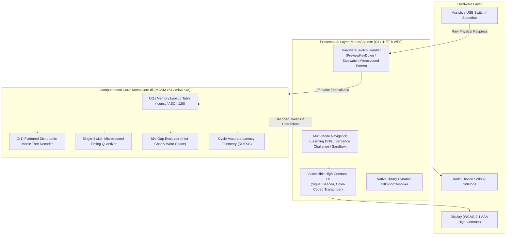

# CONTEXT.md — MorseCodeLearner Architecture & System Context

## 1. Project Overview & Problem Statement

### 1.1 The Assistive Problem
For individuals with severe motor restrictions (e.g., ALS, cerebral palsy, spinal cord trauma), traditional mechanical keyboards and touchscreens demand fine motor control that is inaccessible. Modern commercial speech-to-text or heavy graphical assistive devices often require substantial hardware resources or high operating system overhead that fails in resource-constrained or legacy environments.

Morse code serves as an ultra-low-complexity binary communication protocol capable of bridging auditory, visual, and tactile domains. However, existing pedagogical tools programmed in high-level managed languages introduce non-deterministic execution jitter, garbage collection pauses, and lack low-overhead, hardware-near interactive platforms capable of executing at the system architecture level.

### 1.2 System Objective
To design, implement, and evaluate an **Assembly-based Morse Code Assistive and Pedagogical Platform** that enables individuals with visual, auditory, or motor impairments, as well as students of computer architecture, to systematically practice and utilize Morse code with zero computational latency and deterministic input quantization.

---

## 2. Decoupled Hybrid Architecture

The platform adopts a decoupled hybrid architecture separating raw computational machine-level operations from high-level presentation and accessibility services:



---

## 3. Low-Level ABI & Mathematical Specifications

### 3.1 Microsoft x64 Calling Convention
All routines exported from `MorseCore.dll` follow the standard Microsoft x64 Calling Convention:
- **Integer / Pointer Arguments**: Passed in `RCX`, `RDX`, `R8`, `R9`.
- **Return Values**: Passed in `RAX` (`AX` for 16-bit words, `AL` for bytes).
- **Caller Shadow Space**: 32 bytes (`0x20`) allocated by the caller on the stack before any call.
- **Stack Alignment**: 16-byte boundary maintained at all procedure calls.
- **Volatile Registers**: `RAX`, `RCX`, `RDX`, `R8`, `R9`, `R10`, `R11`.
- **Non-Volatile Registers**: `RBX`, `RBP`, `RDI`, `RSI`, `R12-R15` (must be preserved via push/pop).

### 3.2 Binary Spatial Serialization (Bit-Packed Morse)
To eliminate string heap allocations, each character is represented as a 16-bit packed word (`WORD`):
- **Lower Byte (`AL`)**: Temporal Element Count $N \in [1..6]$ (0 if unmapped).
- **Upper Byte (`AH`)**: Bitmask pattern where bit $N-1$ is the first element and bit 0 is the last element ($0 = \text{Dit } (\cdot), 1 = \text{Dah } (-)$).

### 3.3 Flattened Dichotomic Morse Search Tree ($O(1)$ Reverse Decoding)
The reverse lookup (Morse $\rightarrow$ ASCII) does not traverse a linked tree or loop through string arrays. It indexes a contiguous array in constant time using:
$$\text{Index} = (2^{\text{Count}} - 2) + \text{Pattern}$$

| Count | Pattern (Binary) | Flat Index | Morse Symbol | Decoded ASCII |
| :---: | :---: | :---: | :---: | :---: |
| 1 | $0_2$ | 0 | `.` | **E** |
| 1 | $1_2$ | 1 | `-` | **T** |
| 2 | $00_2$ | 2 | `..` | **I** |
| 2 | $01_2$ | 3 | `.-` | **A** |
| 2 | $10_2$ | 4 | `-.` | **N** |
| 2 | $11_2$ | 5 | `--` | **M** |
| 3 | $000_2$ | 6 | `...` | **S** |
| 3 | $111_2$ | 13 | `---` | **O** |

### 3.4 Single-Switch Timing Quantizer (ITU-R M.1677-1)
Given the base unit duration $T$ in microseconds ($T = 1,200,000 / \text{WPM} \ \mu s$):
- **Debounce Threshold**: $\Delta t < 0.25\, T$ (Rejected as mechanical switch bounce).
- **Dit Classification**: $0.25\, T \le \Delta t < 2.0\, T$ (Token = 1).
- **Dah Classification**: $2.0\, T \le \Delta t < 6.0\, T$ (Token = 2).
- **Over-extended Threshold**: $\Delta t \ge 6.0\, T$ (Rejected as accidental hold).
- **Inter-Character Gap**: Idle time $\ge 300\text{ ms}$ triggers character commit.
- **Word Space Gap**: Idle time $\ge 1000\text{ ms}$ (1 second pause) triggers automatic space insertion.

---

## 4. Repository File Organization

```
MorseCodeLearner/
├── CONTEXT.md                          # Architectural reference and theory
├── PROJECT_HANDOFF.md                  # Developer quickstart and roadmap
├── MorseCodeLearner.sln                # Master Visual Studio 2022 Solution (x64)
│
├── src/
│   ├── MorseCore/                      # MASM x64 Dynamic Link Library Project
│   │   ├── MorseCore.vcxproj           # C++ DLL project with MASM build customizations
│   │   ├── tables/
│   │   │   └── lookup_tables.asm       # .const segment O(1) ASCII & Dichotomic tables
│   │   ├── core/
│   │   │   ├── encoder.asm             # ASCII -> Bit-packed Morse routine
│   │   │   ├── decoder.asm             # Dichotomic Morse -> ASCII routine
│   │   │   ├── quantizer.asm           # Microsecond single-switch threshold classifier
│   │   │   ├── benchmark.asm           # RDTSC cycle-accurate latency counter
│   │   │   └── dllmain.asm             # x64 DLL entry point
│   │   └── include/
│   │       └── morse_defs.inc          # Constants and token equates
│   │
│   └── MorseApp/                       # C# .NET 8 WPF Accessible Presentation Layer
│       ├── MorseApp.csproj             # .NET 8 WPF project (x64 target, AllowUnsafeBlocks)
│       ├── Program.cs                  # Explicit STAThread entry point + Native DllResolver
│       ├── MainWindow.xaml             # Multi-mode XAML layout & Signal Beacon
│       └── MainWindow.xaml.cs          # Event-driven key dispatcher & pedagogical state machine
```
